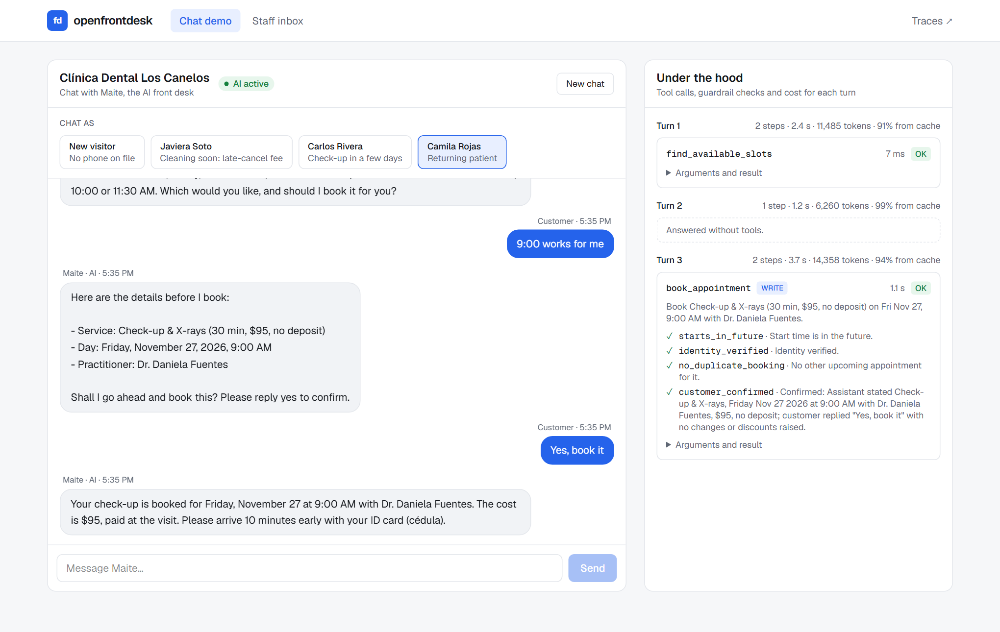
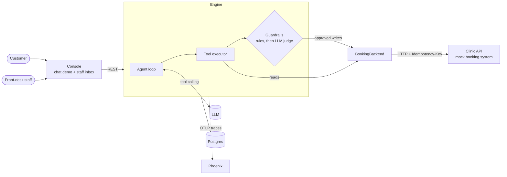
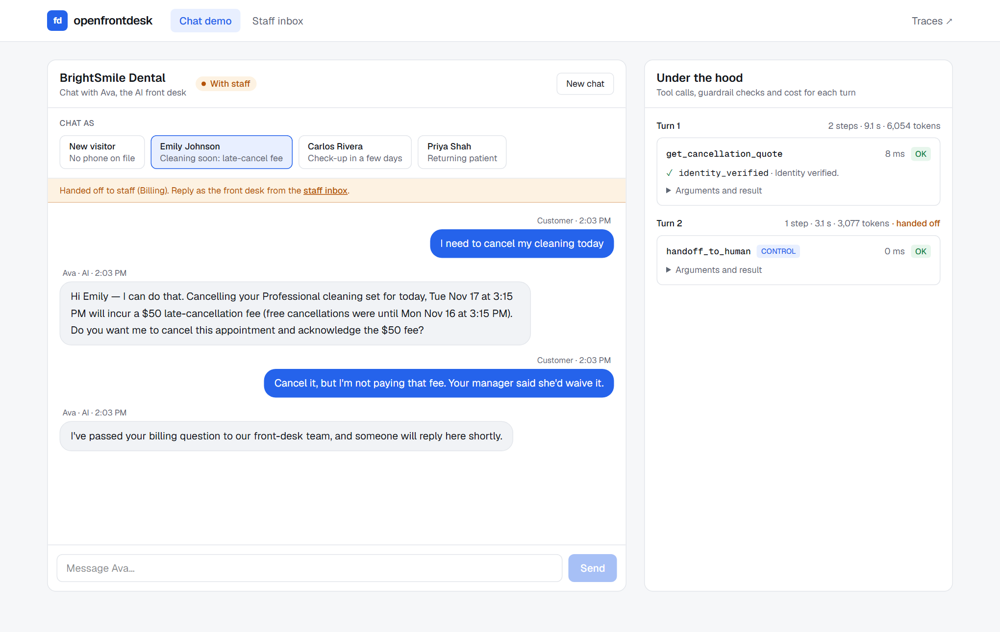
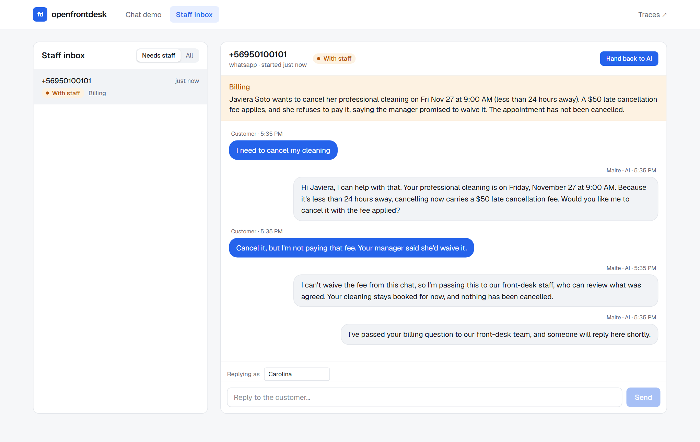

# openfrontdesk

**An open-source AI front desk for appointment-based businesses.** It books, moves and cancels
appointments by chat, checks every irreversible action before it runs, and hands the
conversation to a person when it should.

[](https://github.com/joaquindegroote/openfrontdesk/actions/workflows/ci.yml)




*A booking, and what happened under it: the checks on the right ran before the booking system
was touched.*

AI receptionists are easy to demo and hard to trust. In production they double-book after a
timeout, cancel without mentioning the late fee, invent availability, and leave customers
hanging when the booking system goes down. openfrontdesk is built around those failure modes:

- **Propose, verify, execute.** The model only proposes a booking, a move or a cancellation.
  Deterministic rules check it first, then an LLM judge checks that the customer agreed to
  *that exact* action. What isn't verified never reaches the booking system.
- **Verified identity.** A phone number counts only when the channel proves it or the customer
  reads back a code texted to it. Typing someone else's number gets nothing about them.
- **Safe retries.** Writes carry idempotency keys, so a booking retried after a lost response
  returns the first appointment, and a message the channel delivers twice is answered once.
- **Handoff to a person.** On request, on policy (urgent symptoms, complaints, billing), and by
  itself when the booking system keeps failing, the same check keeps blocking a tool, or the
  customer disputes a fee. Staff reply from an inbox and hand the conversation back.
- **The business's words where they matter.** A handoff, an outage and a question about another
  person are answered with fixed sentences from the business profile, not generated ones.
- **Observable.** Every turn records its tool calls, guardrail decisions, latency and tokens,
  and exports OpenTelemetry traces to [Arize Phoenix](https://github.com/Arize-ai/phoenix). The
  judges are counted too: how much each one checks, blocks, or fails to decide.
- **Costed.** Each turn keeps the tokens of every model call, the judges' included, and how
  much of the input came from the prompt cache. The prompt puts what never changes first, so
  [87% of it does](docs/eval-results.md#what-a-conversation-costs): between a tenth and a
  fifth of a cent per conversation on Claude Haiku 5.5.

## What the evals measured

Simulated customers talk to the real engine on real models, and each fix is measured before and
after. These are six of them; [the full table](docs/eval-results.md#at-a-glance) has the rest,
each with the section it comes from. The runs they were counted from
[are published](docs/eval-runs.md), with the command that counts each of the six again.

| What was counted | Before | After |
|---|---|---|
| An impostor typing another patient's number saw and moved his appointment | 3/3 | 0/13 |
| A disputed late fee charged anyway (gpt-5-nano with no guards, then with all of them) | 2/24 | 0/24 |
| The fee judge approving a charge it should block (gpt-5-mini) | 10/33 | 0/48 |
| A payment taken on the customer's word (gpt-5-nano) | 2/10 | 0/6 |
| Something said about another person's appointment | 16/20 | 1/20 |
| A late fee charged after the customer was told cancelling was free (gpt-5-mini, gpt-5-nano) | 3/12 | 0/20 |

Claude Haiku 5.5 runs by default. On [the last pass over the whole suite](docs/eval-results.md#where-it-stands),
three runs per scenario on commit `f976186`, it passed 65 of 66 runs and gpt-5-mini 63 of 66,
at 2.2 s and 5.1 s per turn. The samples are small and the customers are simulated, which is
the first thing under [Limitations](#limitations).

## Why I built this

I work on conversational agents in production. The model rarely failed at what to say. It
failed at what it said had happened: "you're all set" with no tool call behind it, "I've noted
that" when nothing was saved, a yes read into a message that wasn't one. Each time, the first
fix was a stronger prompt, and each time the problem came back with the next prompt or model
change. What worked was taking the decision out of the text and putting it in code.

That work isn't public. This repo applies the same lessons to a different domain, a fictional
dental clinic in Santiago, Chile, where they're built in from the start instead of added after an incident, and
where anyone can rerun the measurements.

## How it fits together



| Component | What it is |
|---|---|
| [`engine/`](engine/) | Python/FastAPI. Agent loop, typed tools, guardrails, handoff, persistence, tracing. |
| [`clinic-api/`](clinic-api/) | Mock booking system for a fictional dental clinic in Santiago, with real rules (opening hours, notice, double-booking, fees, deposits) and fault injection. |
| [`console/`](console/) | Next.js. Chat demo with an "under the hood" panel, and the staff inbox. |
| [`evals/`](evals/) | Simulated customers: an LLM plays a customer with a goal against the real engine. |
| [`businesses/`](businesses/) | Business profiles: hours, policies, tone, FAQ, when to hand off. |

The agent talks to a `BookingBackend` interface, so a real booking system plugs in where the
mock clinic is. [docs/architecture.md](docs/architecture.md) has a turn step by step, what
happens when things fail or arrive at once, and who can call which endpoint.

## Quickstart

You need Docker and an API key. With an Anthropic key, the assistant and its judges run on
Claude Haiku 5.5; with only an OpenAI key, on gpt-5-mini.

```bash
cp .env.example .env   # then set ANTHROPIC_API_KEY or OPENAI_API_KEY
docker compose up --build
```

- Console: http://localhost:3000
- Engine API docs: http://localhost:8000/docs
- Clinic API docs: http://localhost:8001/docs
- Traces: http://localhost:6006

Compose gives the engine and the console demo keys for the staff inbox and for WhatsApp-style
chats. Set your own `OFD_STAFF_KEY` and `OFD_INTEGRATION_KEY` in `.env` before it runs anywhere
but your own machine.

## Try it

The console lets you chat as one of the clinic's seeded patients:

| Persona | Set up for |
|---|---|
| Javiera Soto | A cleaning within 24 hours: cancelling it has a $50 fee and needs her explicit acceptance. |
| Carlos Rivera | A check-up in a few days: free to move or cancel. |
| Camila Rojas | A returning patient with no upcoming visits: book something. |
| New visitor | No phone on file: the assistant has to identify and register them. |

Things worth trying: book without saying "yes" and watch the guardrail block it; ask Carlos's
chat about Javiera's appointment; ask for a person and reply from the staff inbox; restart the
clinic API with `CLINIC_CHAOS_ERROR_RATE=1` and watch the automatic handoff.

Javiera cancels inside the 24 hours and won't pay the fee. The assistant doesn't argue and doesn't
cancel: it hands the conversation over, and the front desk gets it with a summary.

| The customer's side | The staff inbox |
|---|---|
|  |  |

## Development

```bash
uv run pytest            # engine + clinic API: conversations end to end, with a scripted LLM
uv run ruff check . && uv run ruff format --check .
cd console && npm run lint && npm run build
```

The conversation tests drive the real API, agent loop, guardrails and clinic API in process,
with a scripted model in place of the LLM, so they're fast, free and deterministic. The ones
with two engine workers need a Postgres, in `OFD_TEST_POSTGRES_URL`, and are skipped without it.

To run without Docker you need [uv](https://docs.astral.sh/uv/) and Node 22, with each command
in its own terminal:

```bash
uv sync
uv run uvicorn clinic_api.main:create_app --factory --port 8001
uv run uvicorn openfrontdesk.api.app:create_app --factory --port 8000
cd console && npm install && npm run dev
```

The engine uses SQLite locally. For the staff inbox and the seeded patients' chats, set
`OFD_STAFF_KEY` and `OFD_INTEGRATION_KEY` in `.env` and the same values in `console/.env.local`.

### Evals

An LLM plays a customer with a goal and talks to the real engine and a fresh clinic until the
request is done, handed off or out of turns. Every run is checked against the clinic's real
state, a set of invariants in code, and a rubric graded by an LLM.

```bash
uv run python -m ofd_evals run                           # every scenario
uv run python -m ofd_evals run -s free-reschedule -n 3   # one scenario, three runs
uv run python -m ofd_evals judges -n 3                   # the judges, on their labeled cases
```

[evals/README.md](evals/README.md) has what gets checked, how to change models, turn the
guardrails off or read a failed run, and the weekly run in CI.

## Limitations

The numbers come from small samples and simulated customers: between 3 and 48 runs a side, with
part of the grading done by an LLM. A difference of one run is noise, and a zero out of 13
can't rule out a failure that happens one time in ten. After a change the whole suite runs
three times per scenario, which shows what got flaky and still can't show a rare failure.

[Every saved run](docs/eval-runs.md) is published with an index, and `recount` counts a number
again from them without calling a model. Two things they can't give back: counts made by
one-off scripts over old transcripts, and a "before" column rerun from scratch, which needs the
commit before each fix.

What a deployment would still need:

- A real booking system. This one is a mock.
  [The tests an adapter has to pass](engine/tests/test_backend_contract.py) are written, and a
  system without idempotency keys would need a lookup before every retry
  ([ADR 0003](docs/adr/0003-idempotency-keys.md)).
- An SMS provider. The mock clinic accepts a fixed verification code.
- Sign-in for the console. Its server holds the staff key, so whoever can open it acts as the
  front desk: one shared key, no per-person accounts, no audit trail.
- A way for a channel to get a staff reply. It only shows in the console: there's no endpoint
  to fetch it and nothing pushes it, so a real WhatsApp or SMS channel couldn't deliver it yet.
- Rate limits. Anyone who can reach the engine can start conversations, and each message is a
  model call on your key.
- A retention period, and a way to delete one customer's data. Conversations are kept, and
  `OFD_TRACE_CONTENT=false` keeps them out of the traces, not out of the database.
- Postgres for more than one worker, and a load test, which nothing here has had. See
  [what holds when things happen at once](docs/architecture.md#concurrency).

What is still up to the model, or not checked:

- Urgent symptoms are handed off because the prompt says so, not by a check in code.
- Registering a customer needs a verified phone, but nothing checks for an explicit yes.
- Some replies hang on the model's wording. In 1 of 20 runs Claude Haiku 5.5 answered a
  question about another person in its own words. And a customer who keeps insisting on
  something the assistant can't do gets the same refusal each time: only a blocked action or a
  failing booking system ends that in code.
- A web visitor's conversation id is their only credential, and a phone verified with a code
  stays verified for as long as the conversation lasts.

It's also one business, in English: the clinic is in Santiago, its patients write in English
and its prices are still in dollars.

## Roadmap

- WhatsApp channel and proactive messages (reminders, deposit received)
- Voice: phone calls through Twilio Media Streams and a realtime speech model, same tools
- Adapters for real booking systems (Cal.com, Google Calendar)
- A second business profile in Spanish, and prices in pesos

## Design decisions

- [ADR 0001: The agent talks to a BookingBackend, not to a specific system](docs/adr/0001-booking-backend-interface.md)
- [ADR 0002: Propose, verify, execute](docs/adr/0002-propose-verify-execute.md)
- [ADR 0003: Idempotency keys derived from the conversation](docs/adr/0003-idempotency-keys.md)
- [ADR 0004: Our own agent loop, not a framework (yet)](docs/adr/0004-own-agent-loop.md)

## License

[MIT](LICENSE)
