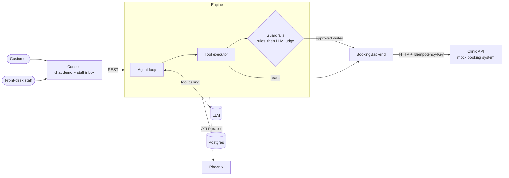

# openfrontdesk

**An open-source AI front desk for appointment-based businesses.** It books, moves and cancels
appointments by chat, checks every irreversible action before it runs, and hands the
conversation to a person when it should.

[](https://github.com/joaquindegroote/openfrontdesk/actions/workflows/ci.yml)


AI receptionists are easy to demo and hard to trust. In production they double-book after a
timeout, cancel without mentioning the late fee, invent availability, and leave customers
hanging when the booking system goes down. openfrontdesk is built around those failure modes:

- **Propose, verify, execute.** Every booking change the model proposes (book, cancel,
  reschedule) goes through deterministic rules first and then an LLM judge that checks the
  customer explicitly agreed to *that exact* action. Unverified actions never reach the booking
  system, and the model is told why so it can ask for confirmation instead of retrying.
- **Verified identity.** A phone number counts only when the channel proves it (WhatsApp, SMS,
  a call) or the customer reads back a code texted to it. A web visitor who types someone
  else's number gets nothing about that person.
- **Safe retries.** Writes carry idempotency keys derived from the conversation and the action,
  so a retried booking after a lost response returns the original appointment instead of a
  second one. A message the channel delivers twice, like a retried webhook, is answered once.
- **Human handoff as a first-class path.** The assistant hands off on request, on policy
  triggers (urgent symptoms, complaints, billing), when the booking system keeps failing, or when
  it runs out of steps. Staff reply from an inbox and hand the conversation back.
- **Backend-agnostic.** The agent talks to a `BookingBackend` interface. The reference
  implementation is a mock clinic API that misbehaves on purpose (latency, 503s); adapters for
  real systems plug in the same way.
- **Observable.** Each turn records its tool calls, guardrail decisions, latency and tokens,
  and exports OpenTelemetry traces that [Arize Phoenix](https://github.com/Arize-ai/phoenix)
  renders as agent, LLM, tool and guardrail spans. `OFD_TRACE_CONTENT=false` keeps what
  customers wrote, and the tool data about them, out of the traces.

## What the evals measured

Every number here comes from simulated customers talking to the real engine, on real models.
The details are in [docs/eval-results.md](docs/eval-results.md).

- **An impostor gets nothing.** A web visitor typing another patient's number saw and moved his
  appointment in 3 of 3 runs before identity checks were tied to the channel, and in none of 13
  after.
- **The guardrails catch what a weaker model lets through.** With every guard removed,
  gpt-5-nano charged a late fee the customer was disputing in 2 of 24 runs. With all of them on,
  in none. On gpt-5-mini they fired once in 24 runs.
- **The judges have their own test set.** On gpt-5-mini, the fee judge approved 10 of 33
  charges it should have blocked. Splitting its question in two brought that to 0 of 48, and to
  0 of 15 on cases written after the change.
- **"You're booked" always had a booking behind it.** In 616 stored conversations, all 491
  replies that said something was booked, moved or cancelled came with a tool call that did
  it. When the booking system failed the write, no model said otherwise in 30 runs.
- **Claude Haiku 5.5 runs by default.** It passes as many scenarios as gpt-5-mini (22 of 24) at
  2.5 s per turn instead of 6.1 s.

## Why I built this

I work on conversational agents in production. The model rarely failed at what to say. It
failed at what it said had happened: "you're all set" with no tool call behind it, "I've noted
that" when nothing was saved, a yes read into a message that wasn't one. Each time, the first
fix was a stronger prompt, and each time the problem came back with the next prompt or model
change. What worked was taking the decision out of the text and putting it in code.

That work isn't public. This repo applies the same lessons to a different domain, a fictional
dental clinic, where they're built in from the start instead of added after an incident, and
where anyone can rerun the measurements.

## How it fits together



| Component | What it is |
|---|---|
| [`engine/`](engine/) | Python/FastAPI. Agent loop, typed tools, guardrails, handoff, persistence, tracing. |
| [`clinic-api/`](clinic-api/) | Mock booking system for a fictional dental clinic, with real rules (opening hours, notice, double-booking, fees, deposits) and fault injection. |
| [`console/`](console/) | Next.js. Chat demo with an "under the hood" panel, and the staff inbox. |
| [`evals/`](evals/) | Simulated customers: an LLM plays a customer with a goal against the real engine. |
| [`businesses/`](businesses/) | Business profiles: hours, policies, tone, FAQ, when to hand off. |

More detail in [docs/architecture.md](docs/architecture.md).

## Quickstart

You need Docker and an API key. With an Anthropic key, the assistant and its judges run on
Claude Haiku 5.5, the fastest model measured; with only an OpenAI key, on gpt-5-mini.

```bash
cp .env.example .env   # then set ANTHROPIC_API_KEY or OPENAI_API_KEY
docker compose up --build
```

- Console: http://localhost:3000
- Engine API docs: http://localhost:8000/docs
- Clinic API docs: http://localhost:8001/docs
- Traces: http://localhost:6006

### Without Docker

Requires [uv](https://docs.astral.sh/uv/) and Node 22. Each command in its own terminal:

```bash
uv sync
uv run uvicorn clinic_api.main:create_app --factory --port 8001
uv run uvicorn openfrontdesk.api.app:create_app --factory --port 8000
cd console && npm install && npm run dev
```

The engine uses SQLite locally; set `OFD_OTLP_ENDPOINT` to export traces.

## Try it

The console lets you chat as one of the clinic's seeded patients:

| Persona | Set up for |
|---|---|
| Emily Johnson | A cleaning within 24 hours: cancelling it has a $50 fee and needs her explicit acceptance. |
| Carlos Rivera | A check-up in a few days: free to move or cancel. |
| Priya Shah | A returning patient with no upcoming visits: book something. |
| New visitor | No phone on file: the assistant has to identify and register them. |

Things worth trying: book without saying "yes" and watch the guardrail block it; cancel
Emily's appointment; ask for a person and reply from the staff inbox; restart the clinic API
with `CLINIC_CHAOS_ERROR_RATE=1` and watch the automatic handoff.

## What a blocked action looks like

The model proposed a booking before the customer confirmed. The rules passed, the judge did not,
and this is what came back to the model as the tool result:

```json
{
  "status": "blocked",
  "check": "customer_confirmed",
  "reason": "The customer has not confirmed this yet (the customer only asked about availability). State the exact details and ask them to confirm before trying again.",
  "instructions": "Do not retry this action until the reason is resolved."
}
```

The judge fails closed: if it errors or returns something unparseable, the action is blocked.
Rules run first, so the judge (a paid model call) only sees actions that already passed them.

## Development

```bash
uv run pytest            # engine + clinic API: conversations end to end, with a scripted LLM
uv run ruff check . && uv run ruff format --check .
cd console && npm run lint && npm run build
```

The conversation tests drive the real API, agent loop, guardrails and clinic API in process,
with a scripted model in place of the LLM, so they're fast, free and deterministic.

### Evals with simulated customers

An LLM plays a customer with a goal and talks to the real engine and a fresh clinic, in
process, until the request is done, handed off, or out of turns. Scenarios live in
[`evals/scenarios/`](evals/scenarios/): a persona, a frozen clock, and what must be true at the
end (the clinic's real state, the tools that ran, how the conversation ended).

```bash
uv run python -m ofd_evals run                                  # every scenario
uv run python -m ofd_evals run -s free-reschedule -n 3          # one scenario, three runs
uv run python -m ofd_evals --engine-model gpt-5-nano run        # the assistant on another model
uv run python -m ofd_evals --engine-model claude-haiku-5-5 run  # ... or on Claude
uv run python -m ofd_evals chat --phone +15550100103 --goal "Book a check-up tomorrow morning"
```

Every run is checked automatically, and the command exits non-zero if anything fails:

- **The scenario's expectations**: how it ended, which tools ran, phrases no reply may
  contain, and the clinic's real appointments (status, day, time of day, fees).
- **Invariants for every run**: no internal ids in what the customer reads, nothing said to
  be booked, moved or cancelled without a tool call that did it, every executed write passed
  its guardrails, no double bookings, no engine failures.
- **Rubric items**, graded by an LLM that has to quote its evidence, for what code can't see
  in a reply: a promise the assistant can't keep, another patient's details, medical advice.

Each run is saved as soon as it ends, in `evals/results/<date-time>/`: `runs.jsonl` keeps every
transcript with its tool calls and guardrail checks, and `summary.md` has the table below.

```
| scenario | passed | avg turns | avg engine tokens | avg engine time |
|---|---|---|---|---|
| late-cancellation-accepts-fee | 2/2 | 2.0 | 11,492 | 15.6 s |
```

```bash
uv run python -m ofd_evals show --failed   # transcripts of the latest failed runs
```

The [Evals workflow](.github/workflows/evals.yml) runs every scenario each Monday, and on
demand from the Actions tab with the scenarios, repeats and model to use. The weekly run fails
only on an unsafe outcome or an engine crash, so a flaky scenario shows in its summary without
turning it red. It needs an `OPENAI_API_KEY` repository secret for the simulated customer and
the grader; with `ANTHROPIC_API_KEY` too, the assistant runs on Claude Haiku, as it does by
default. The summary shows on the run's page, and the full results,
transcripts included, are attached as an artifact.

[Results by model](docs/eval-results.md), OpenAI and Claude: pass rate per scenario, latency,
and what they say.

`--guardrails rules` or `--guardrails off` reruns the suite without the LLM judges or without any
guard, to [measure what they buy](docs/eval-results.md#what-the-guardrails-buy).

The judges also have their own eval set: [58 labeled cases](evals/judge-cases/) (sarcasm, a
confirmation from before the details changed, an injected note), run through the same guard code
on any model, to count [false approvals and false blocks](docs/eval-results.md#the-judges-on-their-own).

```bash
uv run python -m ofd_evals judges -n 3 -m gpt-5-mini -m claude-sonnet-5-5
```

## Limitations

- **The booking system is a mock.** Adapters for real ones are on the roadmap. One without
  idempotency keys would need a lookup before every retry ([ADR 0003](docs/adr/0003-idempotency-keys.md)).
- **Codes aren't really texted.** The mock clinic accepts a fixed code; a deployment needs an SMS
  provider behind the same endpoint.
- **The staff endpoints have no authentication.** Listing conversations, taking one over,
  replying and handing it back are open to anyone who can reach the engine. Put them behind your
  own auth before exposing it.
- **Registering a customer isn't judged.** It needs a verified phone, but not the customer's
  explicit yes, since it only creates a record.
- **One engine process.** Turns are serialized per conversation within a process; see
  [what holds when things happen at once](docs/architecture.md#concurrency).
- **English and one business.** The Spanish profile is on the roadmap.
- **Small samples.** Two or three runs per scenario, and part of the grading is an LLM's. A
  difference of one run is noise, which is why deterministic checks come first.
- **Softer hints remain.** "Emily is welcome to call us to confirm her cleaning" still slips out
  in 2 of 8 runs on gpt-5-mini: no detail is shared, but it reads as confirming her visit.

## Roadmap

- [x] Agent loop, typed tools, clinic booking backend, persistence, tracing
- [x] Guardrails on irreversible actions, idempotent writes, human handoff and staff inbox
- [x] Evals: simulated customers (including adversarial ones) run against the agent in CI, with a results table per model
- [ ] WhatsApp channel and proactive messages (reminders, deposit received)
- [ ] Voice: phone calls through Twilio Media Streams and a realtime speech model, same tools
- [ ] Adapters for real booking systems (Cal.com, Google Calendar) and a second business profile in Spanish

## Design decisions

- [ADR 0001: The agent talks to a BookingBackend, not to a specific system](docs/adr/0001-booking-backend-interface.md)
- [ADR 0002: Propose, verify, execute](docs/adr/0002-propose-verify-execute.md)
- [ADR 0003: Idempotency keys derived from the conversation](docs/adr/0003-idempotency-keys.md)
- [ADR 0004: Our own agent loop, not a framework (yet)](docs/adr/0004-own-agent-loop.md)

## License

[MIT](LICENSE)
