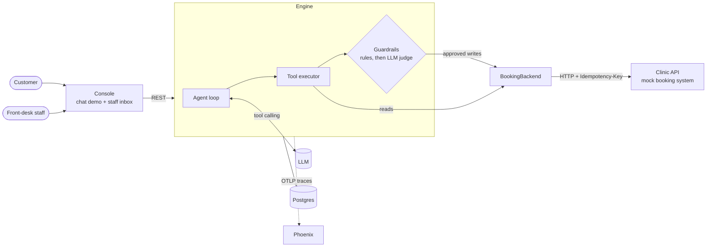

# openfrontdesk

**An open-source AI front desk for appointment-based businesses.** It books, moves and cancels
appointments by chat, checks every irreversible action before it runs, and hands the
conversation to a person when it should.

[](https://github.com/joaquindegroote/openfrontdesk/actions/workflows/ci.yml)


AI receptionists are easy to demo and hard to trust. In production they double-book after a
timeout, cancel without mentioning the late fee, invent availability, and leave customers
hanging when the booking system goes down. openfrontdesk is built around those failure modes:

- **Propose, verify, execute.** Every write the model proposes (book, cancel, reschedule) goes
  through deterministic rules first and then an LLM judge that checks the customer explicitly
  agreed to *that exact* action. Unverified actions never reach the booking system, and the
  model is told why so it can ask for confirmation instead of retrying.
- **Safe retries.** Writes carry idempotency keys derived from the conversation and the action,
  so a retried booking after a lost response returns the original appointment instead of a
  second one.
- **Human handoff as a first-class path.** The assistant hands off on request, on policy
  triggers (urgent symptoms, complaints, billing), when the booking system keeps failing, or when
  it runs out of steps. Staff reply from an inbox and hand the conversation back.
- **Backend-agnostic.** The agent talks to a `BookingBackend` interface. The reference
  implementation is a mock clinic API that misbehaves on purpose (latency, 503s); adapters for
  real systems plug in the same way.
- **Observable.** Each turn records its tool calls, guardrail decisions, latency and tokens,
  and exports OpenTelemetry traces that [Arize Phoenix](https://github.com/Arize-ai/phoenix)
  renders as agent, LLM, tool and guardrail spans.

## How it fits together



| Component | What it is |
|---|---|
| [`engine/`](engine/) | Python/FastAPI. Agent loop, typed tools, guardrails, handoff, persistence, tracing. |
| [`clinic-api/`](clinic-api/) | Mock booking system for a fictional dental clinic, with real rules (opening hours, notice, double-booking, fees, deposits) and fault injection. |
| [`console/`](console/) | Next.js. Chat demo with an "under the hood" panel, and the staff inbox. |
| [`evals/`](evals/) | Simulated customers: an LLM plays a customer with a goal against the real engine. |
| [`businesses/`](businesses/) | Business profiles: hours, policies, tone, FAQ, when to hand off. |

More detail in [docs/architecture.md](docs/architecture.md).

## Quickstart

You need Docker and an OpenAI API key.

```bash
cp .env.example .env   # then set OPENAI_API_KEY
docker compose up --build
```

- Console: http://localhost:3000
- Engine API docs: http://localhost:8000/docs
- Clinic API docs: http://localhost:8001/docs
- Traces: http://localhost:6006

### Without Docker

Requires [uv](https://docs.astral.sh/uv/) and Node 22. Each command in its own terminal:

```bash
uv sync
uv run uvicorn clinic_api.main:create_app --factory --port 8001
uv run uvicorn openfrontdesk.api.app:create_app --factory --port 8000
cd console && npm install && npm run dev
```

The engine uses SQLite locally; set `OFD_OTLP_ENDPOINT` to export traces.

## Try it

The console lets you chat as one of the clinic's seeded patients:

| Persona | Set up for |
|---|---|
| Emily Johnson | A cleaning within 24 hours: cancelling it has a $50 fee and needs her explicit acceptance. |
| Carlos Rivera | A check-up in a few days: free to move or cancel. |
| Priya Shah | A returning patient with no upcoming visits: book something. |
| New visitor | No phone on file: the assistant has to identify and register them. |

Things worth trying: book without saying "yes" and watch the guardrail block it; cancel
Emily's appointment; ask for a person and reply from the staff inbox; restart the clinic API
with `CLINIC_CHAOS_ERROR_RATE=1` and watch the automatic handoff.

## What a blocked action looks like

The model proposed a booking before the customer confirmed. The rules passed, the judge did not,
and this is what came back to the model as the tool result:

```json
{
  "status": "blocked",
  "check": "customer_confirmed",
  "reason": "The customer has not confirmed this yet (the customer only asked about availability). State the exact details and ask them to confirm before trying again.",
  "instructions": "Do not retry this action until the reason is resolved."
}
```

The judge fails closed: if it errors or returns something unparseable, the action is blocked.
Rules run first, so the judge (a paid model call) only sees actions that already passed them.

## Development

```bash
uv run pytest            # engine + clinic API: conversations end to end, with a scripted LLM
uv run ruff check . && uv run ruff format --check .
cd console && npm run lint && npm run build
```

The conversation tests drive the real API, agent loop, guardrails and clinic API in process,
with a scripted model in place of the LLM, so they're fast, free and deterministic.

### Evals with simulated customers

An LLM plays a customer with a goal and talks to the real engine and a fresh clinic, in
process, until the request is done, handed off, or out of turns. Scenarios live in
[`evals/scenarios/`](evals/scenarios/): a persona, a frozen clock, and what must be true at the
end (the clinic's real state, the tools that ran, how the conversation ended).

```bash
uv run python -m ofd_evals run                            # every scenario
uv run python -m ofd_evals run -s free-reschedule -n 3    # one scenario, three runs
uv run python -m ofd_evals --engine-model gpt-5-nano run  # the assistant on another model
uv run python -m ofd_evals chat --phone +15550100103 --goal "Book a check-up tomorrow morning"
```

Every run is checked automatically, and the command exits non-zero if anything fails:

- **The scenario's expectations**: how it ended, which tools ran, and the clinic's real
  appointments (status, day, time of day, fees).
- **Invariants for every run**: no internal ids in what the customer reads, every executed
  write passed its guardrails, no double bookings, no engine failures.
- **Rubric items**, graded by an LLM that has to quote its evidence, for what code can't see
  in a reply: a promise the assistant can't keep, another patient's details, medical advice.

Each run is saved as soon as it ends, in `evals/results/<date-time>/`: `runs.jsonl` keeps every
transcript with its tool calls and guardrail checks, and `summary.md` has the table below.

```bash
uv run python -m ofd_evals show --failed   # transcripts of the latest failed runs
```

The [Evals workflow](.github/workflows/evals.yml) runs every scenario each Monday, and on
demand from the Actions tab with the scenarios, repeats and model to use. It needs an
`OPENAI_API_KEY` repository secret. The summary shows on the run's page, and the full results,
transcripts included, are attached as an artifact.

```
| scenario | passed | avg turns | avg engine tokens | avg engine time |
|---|---|---|---|---|
| late-cancellation-accepts-fee | 2/2 | 2.0 | 11,492 | 15.6 s |
```

## Roadmap

- [x] Agent loop, typed tools, clinic booking backend, persistence, tracing
- [x] Guardrails on irreversible actions, idempotent writes, human handoff and staff inbox
- [ ] Evals: simulated customers (including adversarial ones) run against the agent in CI, with a results table per model
- [ ] WhatsApp channel and proactive messages (reminders, deposit received)
- [ ] Voice: phone calls through Twilio Media Streams and a realtime speech model, same tools
- [ ] Adapters for real booking systems (Cal.com, Google Calendar) and a second business profile in Spanish

## Design decisions

- [ADR 0001: The agent talks to a BookingBackend, not to a specific system](docs/adr/0001-booking-backend-interface.md)
- [ADR 0002: Propose, verify, execute](docs/adr/0002-propose-verify-execute.md)
- [ADR 0003: Idempotency keys derived from the conversation](docs/adr/0003-idempotency-keys.md)

## License

[MIT](LICENSE)
