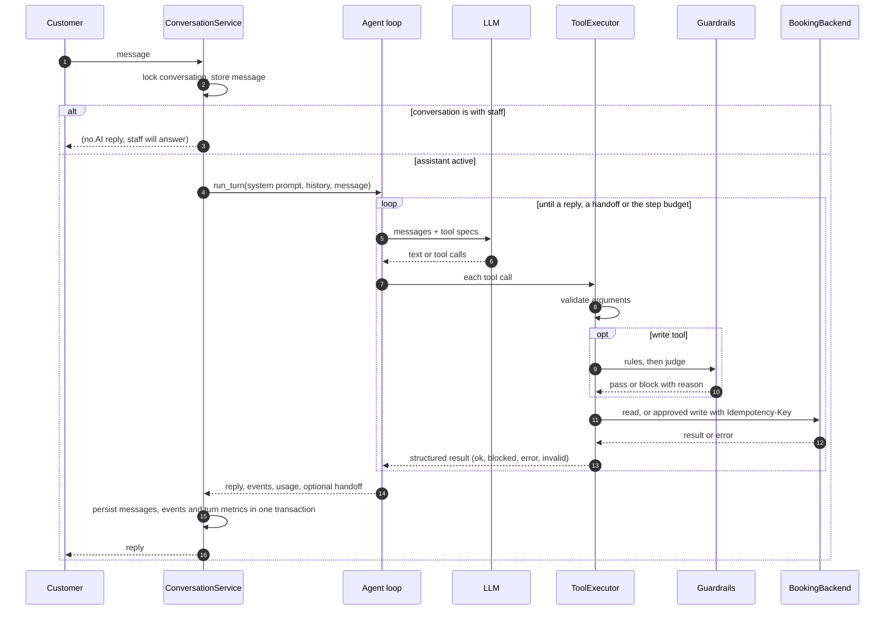

# Architecture

## A customer turn



## Engine modules

| Module | Responsibility |
|---|---|
| `api/` | FastAPI routes and response schemas. No business logic. |
| `service.py` | Conversation lifecycle: who replies, per-conversation locking, a deadline for each turn, persistence of each turn, and failure handling (a failed turn hands off and never stores a tool call without its result). |
| `agent/loop.py` | The bounded loop for one turn: step budget, automatic handoff after repeated outages, and the business's fixed reply to close any handoff. |
| `agent/executor.py` | Runs one tool call: validation, guards, idempotency key, timeout, and turning every failure into a result the model can act on. |
| `agent/prompt.py` | Renders the system prompt in two parts: the rules and the business profile, the same for everyone, and then the time in the business's timezone, the customer and their appointments. |
| `tools/` | Typed tool registry and the standard booking toolset. Arguments are Pydantic models; their JSON schema is what the model sees. |
| `guardrails/` | Deterministic rules and the two LLM judges: one for the customer's confirmation, one for a fee. |
| `backends/` | The `BookingBackend` interface and the clinic API adapter (retries only what is safe to retry). |
| `llm/` | Provider-neutral chat types, the OpenAI and Claude adapters (picked by model name) and a scripted model for tests. |
| `storage/` | SQLAlchemy models and the repository. SQLite in development, Postgres in Docker. |
| `observability.py` | OpenTelemetry setup with OpenInference attributes for Phoenix. |

## Failure handling

| Failure | What happens |
|---|---|
| Model passes invalid arguments | The tool isn't run. The model gets the validation errors and corrects itself. |
| Model proposes an unconfirmed write | Blocked by the judge. The model gets the reason and asks the customer. |
| Model keeps proposing an action the guards block | After the same check blocks the same tool three times in a row, whatever the arguments, automatic handoff with reason `blocked_repeatedly`. Staff read what was tried and why it was stopped. |
| Judge errors or returns garbage | Blocked (fails closed). |
| Customer pushes back on a fee they were quoted | The fee judge is asked when the customer writes while a quoted fee is unpaid, and when a quote comes back with a fee. If it says they object, the turn ends there with the business's reply and reason `fee_dispute`, before the model answers. Only what was written since a person last replied counts. If the judge can't answer, nothing is handed off and the guards on the cancellation still apply. |
| Booking system times out on a write | Retried with the same idempotency key; the booking system returns the original result if the first attempt went through. |
| Booking system keeps failing | After two consecutive steps of temporary failures, automatic handoff with reason `system_unavailable`. The customer is told the request wasn't finished. |
| Model loops | Step budget (default 8) ends the turn with a handoff. |
| LLM API fails mid-turn | Whatever the turn did is persisted, the customer gets a holding reply, and the conversation goes to staff. |

### What a blocked action looks like

The model proposed a booking before the customer confirmed. The rules passed, the judge did not,
and this is what came back to the model as the tool result:

```json
{
  "status": "blocked",
  "check": "customer_confirmed",
  "reason": "The customer has not confirmed this yet (the customer only asked about availability). Tell the customer what you are about to do, with these details as they are written, and ask them to confirm before trying again: Book Check-up & X-rays (30 min, $95, no deposit) on Tue Nov 3, 10:00 AM with any available practitioner.",
  "instructions": "Do not retry this action until the reason is resolved."
}
```

The judge fails closed: if it errors or returns something unparseable, the action is blocked.
Rules run first, so the judge (a paid model call) only sees actions that already passed them.

### Who watches the judges

A judge is a model call, and it can stop working without anything crashing: a provider changes
the model behind a name, a key runs out, a prompt edit makes it answer in prose. It fails closed,
so nothing unsafe happens, but every booking gets blocked and the first to notice is a customer.

`GET /v1/guardrails?hours=24`, with the staff key, counts what each check did lately: how many
actions it looked at, how many it blocked, and how many of those blocks were the check not
being able to decide.

```json
{"name": "customer_confirmed", "checked": 212, "blocked": 9, "undecided": 0}
```

Three things to alert on: `undecided` above zero (the judge is failing), `blocked` equal to
`checked` (it blocks everything), and `blocked` at zero over many checks (it may be approving
everything, which the weekly evals would confirm).

## Concurrency

| Situation | What holds | Test |
|---|---|---|
| Two messages in one conversation at once (a double send) | The turns run one after the other, and the second sees the first. | `engine/tests/test_concurrency.py` |
| One message delivered twice by the channel (a retried webhook) | With the channel's `message_id`, the copy gets the first outcome back marked `duplicate`, and no second turn runs. That holds when the copy arrives while the first is still being answered. | `engine/tests/test_redelivery.py` |
| Messages in different conversations | They don't wait for each other. | `engine/tests/test_concurrency.py` |
| Two engine workers get messages for the same conversation, or the same message | On Postgres, one turn at a time across workers, and one answer for a message both received. | `engine/tests/test_two_workers.py`, against a real Postgres in CI |
| A write retried after a timeout or a lost response | Same idempotency key, so the booking system returns the original result instead of booking twice. | `test_retried_booking_is_deduplicated_by_the_clinic` |
| The engine dies after a booking and before saving the turn | The channel delivers the message again and the turn runs again. If the model proposes the booking with the same arguments, it goes out with the same key, which is made from them, and the booking system answers with the first appointment. If it words them differently, the key differs and the booking system refuses it because the patient already has that time: nothing is booked twice, but the assistant has to work it out from an error. | `test_a_crash_after_the_booking_and_before_the_save_books_once` |
| The same key sent with different arguments | Rejected by the booking system (`idempotency_key_reused`). | `test_reusing_an_idempotency_key_for_another_request_is_rejected` |
| Two customers going for the same slot | The first gets it, the second gets `slot_unavailable` and is offered other times. | `test_booking_is_idempotent_and_prevents_double_booking` |
| A second booking for a service the customer already has coming up | Blocked by `NoDuplicateBooking`, unless the customer asked to keep both. | `test_duplicate_booking_rule` |

A turn takes two locks on its conversation. The first is in the process, and exists only
while a turn holds or waits for it. The second is a Postgres advisory lock, which every worker
on the same database shares, so several engine processes can run side by side. It's held on a
connection from a pool of its own, so turns waiting for a conversation can't use up the
connections the queries need, and Postgres drops it if the process dies mid-turn. That pool
allows 50 turns running or waiting per process.

On SQLite there's only the first lock, which is fine for one process and wrong for more. Either
way the booking system prevents double bookings and repeated writes by itself, because
idempotency keys come from the conversation and not from the process.

## Prompt order and the cache

A request to the model goes from what changes least to what changes most:

1. The tools.
2. The rules, the business's information and its services: the same for every customer.
3. This conversation: the time, who is writing, their appointments.
4. The messages so far.

Model providers keep a prompt they have just seen and charge a fraction to read it again, up
to the first character that differs. Parts 1 and 2, about 4,800 of 5,100 tokens, are read from
the cache by any call made within five minutes of another, whoever the customer is. A time or
a name near the top would end that: no two turns would share anything, and each would pay to
write the whole prompt to the cache. The Claude adapter marks the end of 2. OpenAI caches a
repeated prefix without being asked.

Three things keep it that way:

- `render_system_prompt` renders part 2 with nothing but the business profile and the services,
  so a time or a name can't get into it.
- A test opens conversations for three different customers and checks that the first message
  the model gets is the same in all of them.
- Every turn stores how much of its input was read from the cache and how much was written. A
  request that misses the cache still succeeds, at a higher price, so that number is the only
  place where it shows.

[What it measured](eval-results.md#what-a-conversation-costs): 87% of the input read from the
cache instead of 37%, and less than half the cost per conversation.

## Who can call what

| Endpoints | Who calls them | What they need |
|---|---|---|
| `GET /v1/business`, `POST /v1/conversations` for a web chat, `POST /v1/conversations/{id}/messages` | A channel: the chat widget, or an integration's server | Only the conversation's id, which the one who started it holds |
| `POST /v1/conversations` for WhatsApp, SMS or voice | An integration, since the carrier proves the phone | `X-Integration-Key`. Without a key set, these channels are off. |
| Listing and reading conversations, taking one over, replying as staff, handing it back, and the guardrail counts | The front desk, through the console | `Authorization: Bearer <OFD_STAFF_KEY>`. Without a key set, these are off. |

The console's browser code never holds a key: it calls the console's own server, which adds
them and forwards to the engine. The chat demo plays a WhatsApp channel for the seeded
patients, so the console holds the integration key too. Keys are compared in constant time. The API docs at
`/docs` mark the staff endpoints, and take the key under "Authorize".

What comes back to a caller without the staff key is the replies and the conversation's status.
The turn's tool events, its model and token counts, and the summary the assistant wrote for
staff when it handed off, go only to a caller with the key: a visitor can get the model to try anything, and the events of a
blocked try are not theirs to read.

## Data model

- `conversations`: channel, customer phone, status (`active` or `handed_off`), handoff reason and summary.
- `messages`: the model-facing transcript (customer, assistant, tool and staff messages), in order.
- `tool_events`: every tool call with arguments, status, result, guardrail checks and duration. This is the audit trail.
- `turns`: per-turn steps, latency, model and outcome, and the tokens of every model call it
  made, the judges' included: by model, with how much of the input was read from the prompt
  cache and how much was written to it.
