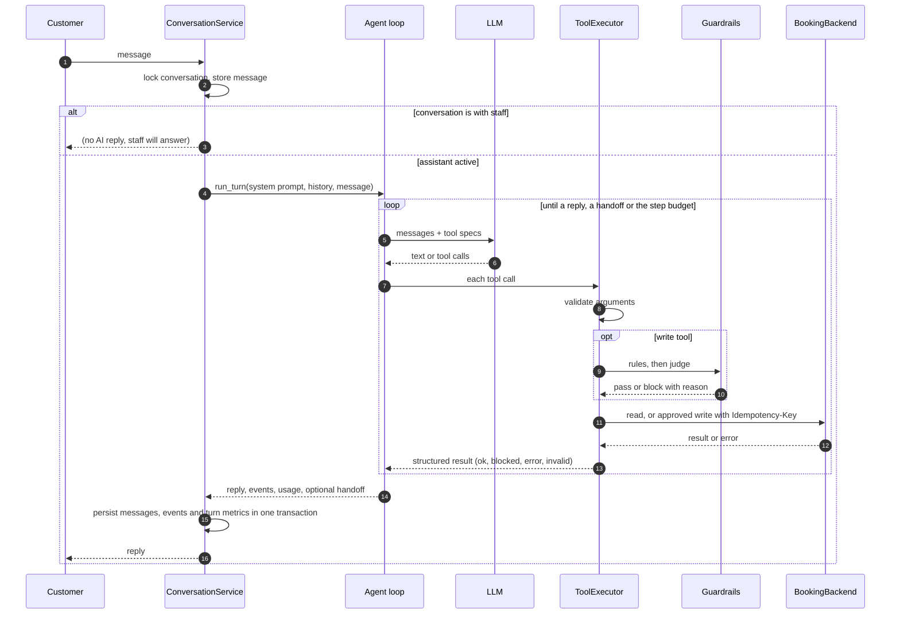

# Architecture

## A customer turn

## Engine modules

| Module | Responsibility |
|---|---|
| `api/` | FastAPI routes and response schemas. No business logic. |
| `service.py` | Conversation lifecycle: who replies, per-conversation locking, a deadline for each turn, persistence of each turn, and failure handling (a failed turn hands off and never stores a tool call without its result). |
| `agent/loop.py` | The bounded loop for one turn: step budget, automatic handoff after repeated outages, closing message after a handoff. |
| `agent/executor.py` | Runs one tool call: validation, guards, idempotency key, timeout, and turning every failure into a result the model can act on. |
| `agent/prompt.py` | Renders the system prompt from the business profile and the current time in the business's timezone. |
| `tools/` | Typed tool registry and the standard booking toolset. Arguments are Pydantic models; their JSON schema is what the model sees. |
| `guardrails/` | Deterministic rules and the confirmation judge. |
| `backends/` | The `BookingBackend` interface and the clinic API adapter (retries only what is safe to retry). |
| `llm/` | Provider-neutral chat types, the OpenAI adapter and a scripted model for tests. |
| `storage/` | SQLAlchemy models and the repository. SQLite in development, Postgres in Docker. |
| `observability.py` | OpenTelemetry setup with OpenInference attributes for Phoenix. |

## Failure handling

| Failure | What happens |
|---|---|
| Model passes invalid arguments | The tool isn't run. The model gets the validation errors and corrects itself. |
| Model proposes an unconfirmed write | Blocked by the judge. The model gets the reason and asks the customer. |
| Judge errors or returns garbage | Blocked (fails closed). |
| Booking system times out on a write | Retried with the same idempotency key; the booking system returns the original result if the first attempt went through. |
| Booking system keeps failing | After two consecutive steps of temporary failures, automatic handoff with reason `system_unavailable`. |
| Model loops | Step budget (default 8) ends the turn with a handoff. |
| LLM API fails mid-turn | Whatever the turn did is persisted, the customer gets a holding reply, and the conversation goes to staff. |

## Data model

- `conversations`: channel, customer phone, status (`active` or `handed_off`), handoff reason and summary.
- `messages`: the model-facing transcript (customer, assistant, tool and staff messages), in order.
- `tool_events`: every tool call with arguments, status, result, guardrail checks and duration. This is the audit trail.
- `turns`: per-turn steps, tokens, latency, model and outcome.
